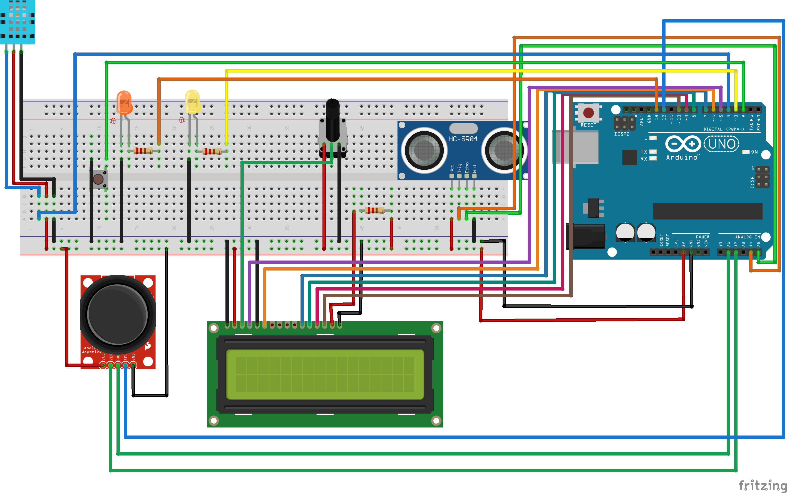
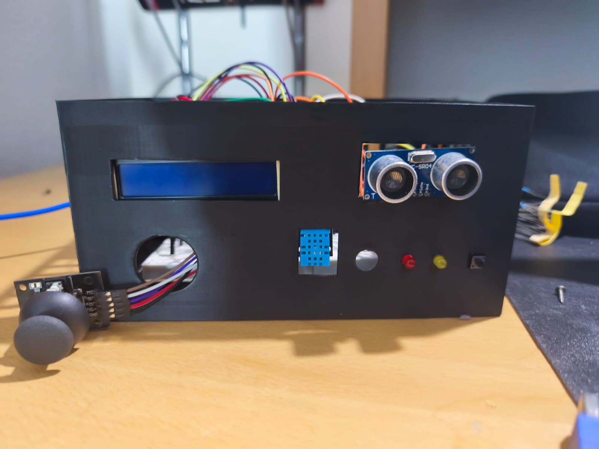
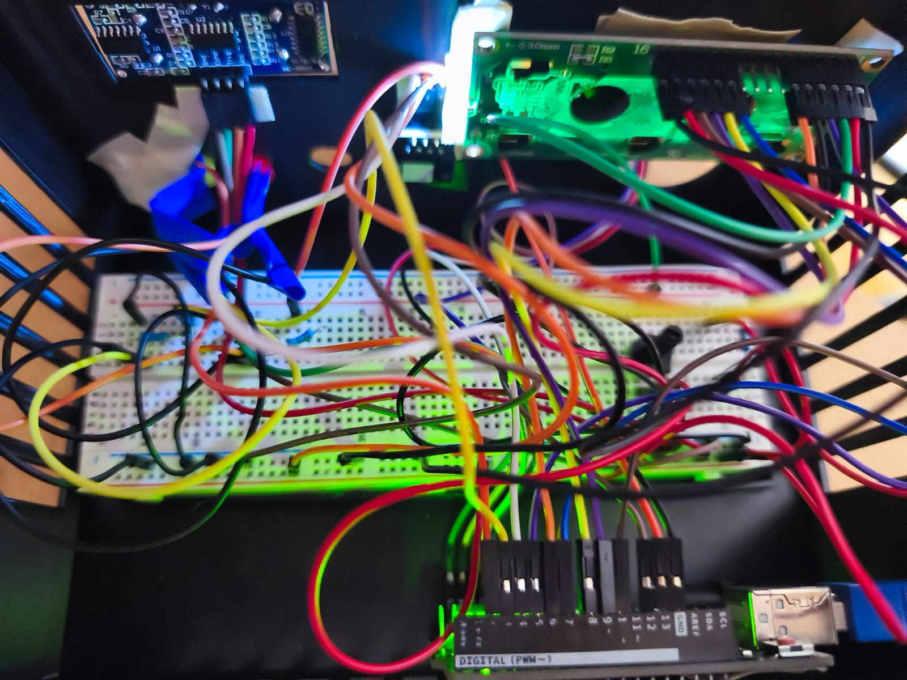
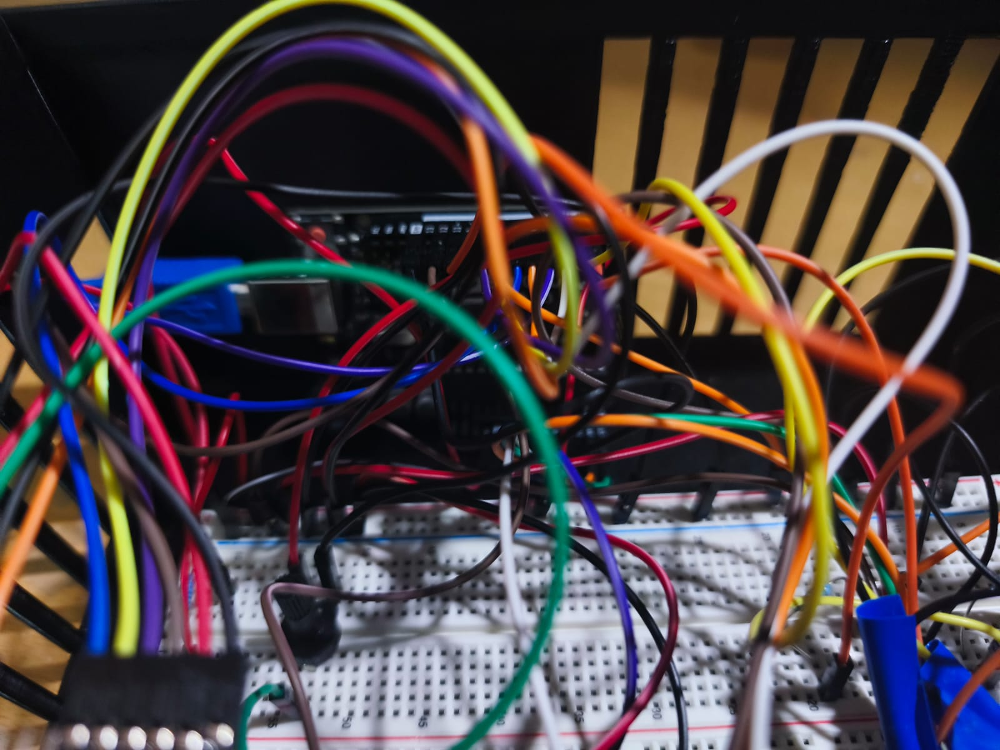
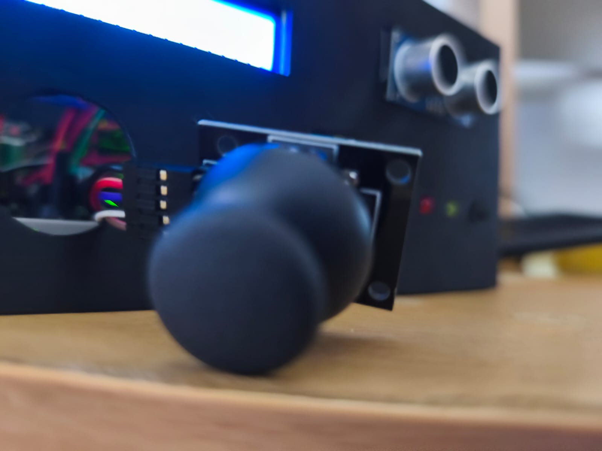

# Práctica 3: Máquina expendedora

Proyecto para la asignatura **Sistemas Empotrados y de Tiempo Real**. Claudia Élez Mencía.

El proyecto se trata de una máquina expendedora de café. La máquina espera a que se acerque una persona, muestra un catálogo en la LCD y permite navegar con el joystick. También tiene un menú de administración para consultar los sensores y cambiar los precios.

## Elementos utilizados

- Arduino Uno.
- Una pantalla LCD1602.
- Un potenciómetro
- Joystick analógico con botón.
- Sensor ultrasónico HC-SR04.
- Módulo DHT11 de tres pines.
- Dos LED
- Un botón.
- Tres resistencias de 220 Ohms (2 para los leds y una para la retroiluminación de la LCD)

## Circuito

El esquema en fritzing está en [fritzing/pinout_maquina_expendedora.fzz](fritzing/pinout_maquina_expendedora.fzz) 

Este es el circuito resultante:

### Montaje real

*Vista frontal: LCD, sensor ultrasónico, DHT11, joystick, LED y botón.*

| Pines del Arduino Uno | Componente | Conexión |
| --- | --- | --- |
| D2 | Botón | Entre D2 y GND, se configura como `INPUT_PULLUP`. |
| D3 (PWM) | LED2 | Con resistencia de 220 Ohm en serie. |
| D4 | DHT11 | Señal DATA. |
| D5, D6 | LCD | RS y E |
| D7–D10 | LCD | Pines D4–D7. |
| D11 | LED1 | Con resistencia de 220 Ohm en serie. |
| D12 | Joystick | SW |
| A1, A2 | Joystick | VRx e VRy respecticamente |
| A4, A5 | HC-SR04 | TRIG y ECHO. |

El V0 de la LCD se ha conectado a la salida de un potenciómetro, para poder
regular, la visibilidad de los caracteres.

## Organización del código

El fichero `.ino` configura el hardware, crea los objetos y coordina los modos desde el bucle inicial `loop()`.

- `StartupMode.h`: pantalla de arranque y los tres destellos de LED1.
- `ServiceMode.h`: espera de cliente, monitorización, catálogo y preparación.
- `ServiceMenu.h`: navegación por el catálogo y selección del producto.
- `AdminMode.h`: menú de administración, consultas y edición de precios.
- `ProductCatalog.h`: nombres y precios compartidos por los menús.
- `JoystickThread.h`: lee el joystick aproximadamente cada 40 ms, filtra el estado del botón y guarda eventos para que el programa los recoja. El joystick está girado en la carcasa, así que el programa adapta el mapeo de sus ejes.
- `DhtThread.h`: lee temperatura y humedad cada dos segundos cuando está habilitada.
- `UltrasonicThread.h`: mide el HC-SR04 con una máquina de estados y entrega la mediana de tres muestras.
- `LedThread.h`: controla cada LED: permite parpadear, aumentar el brillo progresivamente o dejarlo en un nivel fijo.
- `Button.h`: aplica antirrebote al botón externo y decide qué acción realizar según cuánto tiempo se mantuvo pulsado.

## Sensor ultrasonido:

`UltrasonicThread` guarda marcas de tiempo con `micros()` y en cada llamada a `run()` comprueba si toca avanzar al siguiente paso: iniciar el pulso TRIG, detectar el eco o finalizar la medición.

## Configuración del watchdog

Al principio de `setup()`, `MCUSR = 0` borra las banderas que indican la causa del reinicio anterior, como un encendido, el botón RESET o el watchdog. Después, `wdt_disable()` mantiene desactivado el watchdog mientras se inicializa el hardware. Una vez terminada la inicialización, `wdt_enable(WDTO_2S)` lo activa con un plazo de dos segundos.

Al comienzo de cada vuelta de `loop()`, `wdt_reset()` reinicia ese plazo para indicar que el programa sigue avanzando. Si el código se bloquea y deja de ejecutar `wdt_reset()` durante dos segundos, el watchdog reinicia la placa. No detecta errores lógicos si el programa continúa ejecutando `loop()`.

## Interrupciones y avisos entre tareas:

El botón externo de D2 usa una interrupción de hardware configurada para detectar cambios al pulsarlo y soltarlo. `ExternalButtonIsr()` solo activa la flag `btn_changed`. Después, `loop()` procesa el antirrebote, la duración y la acción mediante `Button::Update()`.

Por otro lado:

- El joystick guarda un evento en `pending`, el programa lo recoge con `TakeEvent()`.
- El DHT11 señala una lectura nueva con `new_read`, se recoge con `TakeReading()`.
- El HC-SR04 deja una distancia nueva en `new_measure`, se recoge con `TakeMeasurement()`.

Estos avisos no interrumpen el código. Solo indican que hay un dato pendiente para atender en una vuelta posterior. `ThreadController` también es cooperativo: revisa las tareas desde `loop()`.

# Librerías utilizadas

Estas son las bibliotecas que se han utilizado en el sketch:

- **LiquidCrystal** (`LiquidCrystal.h`): para controlar la pantalla LCD.
- **ArduinoThread** (`Thread.h` y `ThreadController.h`): permite organizar el joystick, el DHT11, el sensor ultrasónico y los LED como tareas cooperativas.
- **DHT sensor library**, de Adafruit (`DHT.h`): lee la temperatura y la humedad del DHT11.
- **Adafruit Unified Sensor**: dependencia de la librería DHT de Adafruit. 
- **AVR Watchdog** (`avr/wdt.h`): para la configuración del watchdog de la placa.

El HC-SR04 no usa una biblioteca externa en este proyecto. `UltrasonicThread.h` controla sus pines y calcula la distancia con una máquina de estados.

## Otros recursos:

- [Blog web de la práctica](https://celezm.github.io/blog_setr_maquina_expendedora/).
- [Modelo 3D de la carcasa](carcasa/carcasa_dos_piezas.FCStd), con las piezas [base.stl](carcasa/base.stl) y [tapa.stl](carcasa/tapa.stl).
- [Video demostración del funcionamiento](media/demo-p3-setr.mp4), para esta demostración se ha modificado el threshold del ultrasonidos de 1m a 10 cm, para poder mostrar mejor la etapa de espera.

